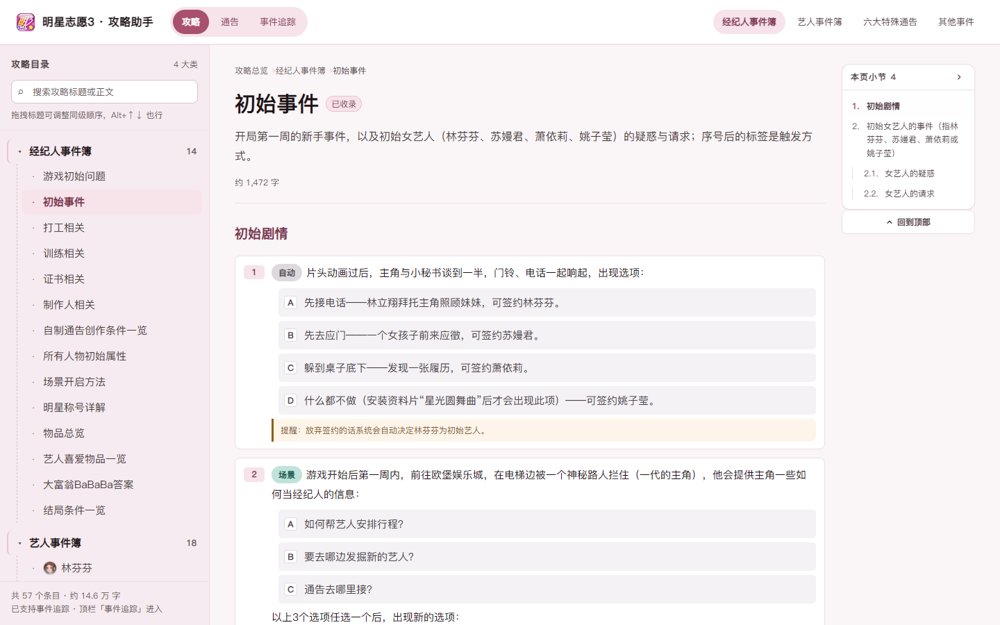
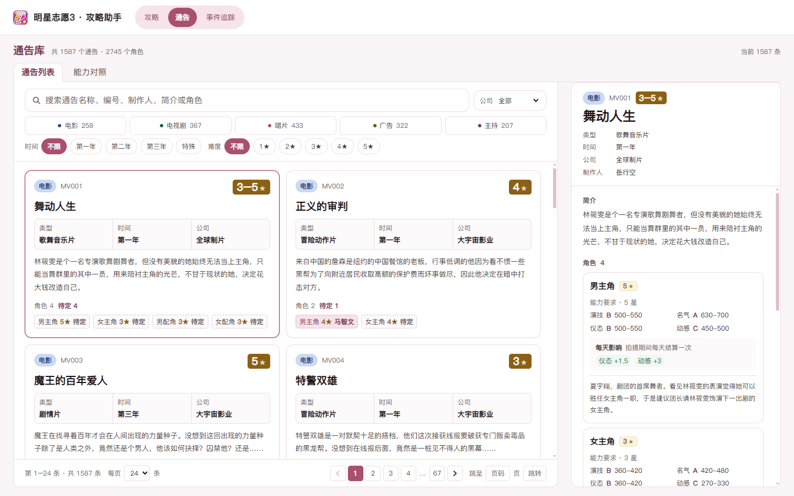
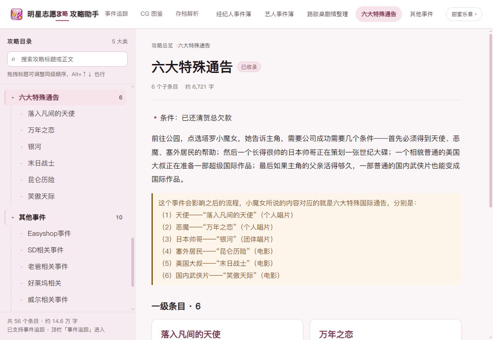
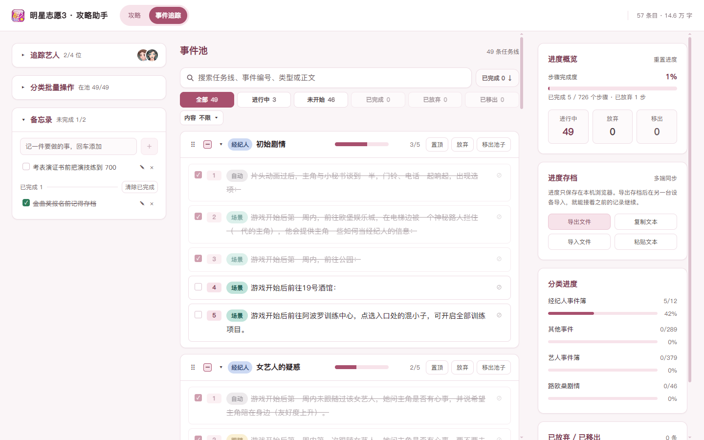
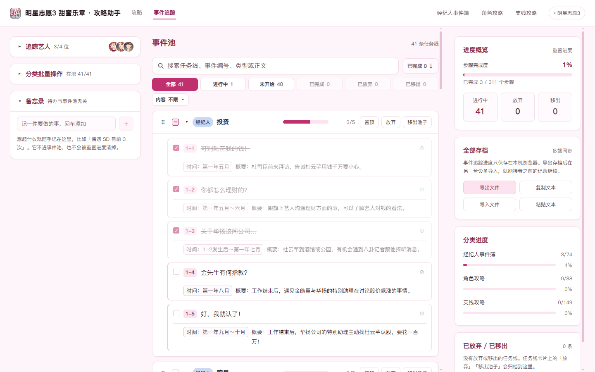
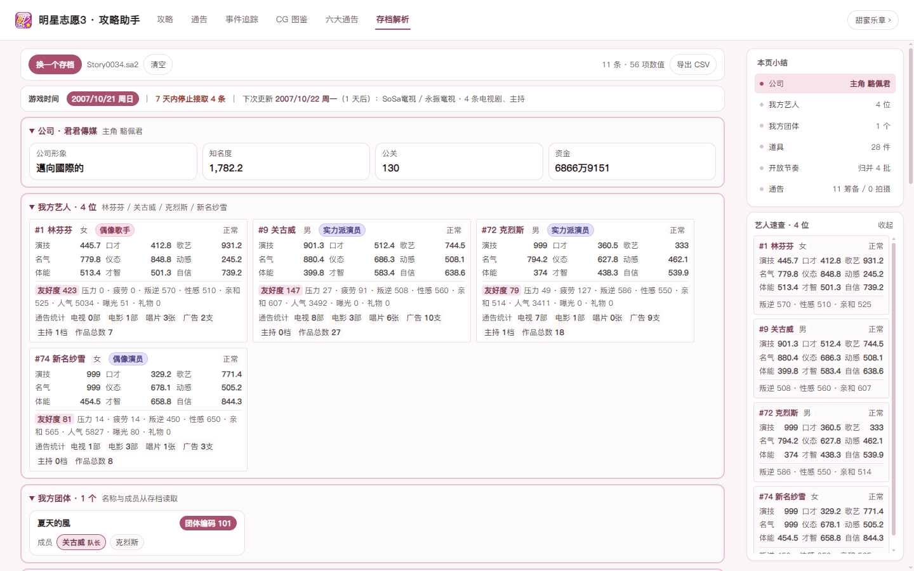

# 明星志愿3 攻略助手

《明星志愿3》与《明星志愿3 甜蜜乐章》的攻略网页版：攻略浏览、通告库、六大特殊通告、事件追踪、CG 图鉴与存档解析。纯静态站点，无需登录，进度保存在本机浏览器。

## 两个站点

| 入口 | 站点 | 主题 |
| --- | --- | --- |
| `index.html`（`/`） | 明星志愿3 · 攻略助手 | 玫瑰粉 |
| `sweet.html`（`/sweet.html`） | 明星志愿3 甜蜜乐章 · 攻略助手 | 糖果粉 |

两个站点共用同一套排版与组件，甜蜜乐章只换主题色；攻略数据、目录顺序、追踪进度、备忘录与存档各自独立，改一边不会动到另一边。顶栏右上角可整页切换。

## 界面预览

<details>
<summary>点击展开各页面截图</summary>

**攻略浏览**



**通告库**



**六大特殊通告**



**事件追踪**



**甜蜜乐章事件追踪**



**CG 图鉴**


**甜蜜乐章 CG 图鉴**


**存档解析**



</details>

## 能做什么

全站图片按需加载，点开看大图先给同尺寸预览，原图到位后由糊变清晰、大小始终不变。

### 攻略浏览

- 按经纪人事件簿、艺人事件簿、路欧桑剧情整理、六大特殊通告、其他事件分类浏览，支持搜索、锚点分享与常驻大纲
- 目录顺序可拖拽调整；关键事件带 CG 徽标，可直达图鉴里对应的那张
- 「小贴士」汇总培训打工、证书、制作人方向与颁奖日程等速查表

### 通告库

- 收录 1587 条通告与 2745 个角色要求，覆盖电影、电视剧、唱片、广告、主持五类
- 可按分类 / 年份 / 公司 / 难度筛选并搜索，详情列出角色能力要求、特殊要求与拍摄期属性增减
- 另有「能力对照」速查页，汇总难度换算、成长率等数据

### 六大特殊通告

- 攻略浏览集中整理六张特殊通告的条件与事件节点；存档解析里的助手按当前存档判断达成情况，可指派艺人并跟踪证书、课程与属性进度
- 条件按公司 / 艺人 / 团体 / 角色位归属，同一艺人在多张卡上的状态共享
- 事件节点可跳回攻略，艺人匹配连同角色位证书一起判断

### 事件追踪

- 选定签约艺人后按章节生成事件线，可标记完成 / 放弃，可按状态、追踪艺人、事件分类筛选，并搜索、拖拽排序与批量操作
- 内置独立备忘录；进度按事件内容对齐，攻略更新后不会错位

### CG 图鉴

- 收录明星志愿3 的 204 张与甜蜜乐章的 83 张 CG，按人物分组展示头像与收集进度
- 支持三档卡片尺寸、只看未收集、大图翻页与快速标记；CG 与攻略可双向跳转
- 可清除已收集（支持撤销），也能整体导出备份

### 存档解析

- 上传 `.sa2` 存档，**只在本地浏览器解析、不上传**；展示公司信息、艺人属性与状态、通告统计、称号门槛与获奖记录、团体、道具、已解锁场景与合约信息
- 通告按筹备中 / 拍摄中 / 自制 / 宣传 / 等待上市 / 热卖中 / 已完成分列，列出角色预约、所需数值对比、拍摄进度与酬劳，可按类型 / 公司 / 艺人等筛选并导出 CSV
- 作品数可悬停看逐部明细（发生日期、角色、制作公司）；称号升级会连同攻略注明的奖项、演唱会等附加条件一起判断
- 右下角 NP鸡汇总六大特殊通告在当前存档下的达成情况，可拖动、浮窗随位置自动避让视口边缘；艺人匹配连同角色位证书一起判断，事件节点可跳回攻略
- 「制作人好感」按唱片 / 电视剧 / 电影 / 广告 / 主持 / 其他六类列出制作人，友好度直接读当前存档
- 右侧艺人速查按人挂在拍通告，团体通告两位成员都看得到；进度与风险一眼可见。本页小结默认收起，展开后可跳到各张卡
- 「本周便签」导入自己维护的 Excel 模板后，按当前存档的游戏日期落在哪周，提醒当周排班与心得；便签独立于存档，切换存档不变，只提醒、不写回
- 属性缺口悬停可看推荐课程

### 桌面版（存档解析）

- 独立的 Windows 桌面应用，只做存档解析一件事；自己选择游戏的 Save2 存档目录，点「读取当前游戏状态」即可显示该存档，不必每次找文件拖入
- 也可以从「文件」菜单直接打开单个 `.sa2` 存档，随时重新载入当前存档
- 存档位可选最近改动或指定某一档；可开「自动跟随」，游戏一存档页面就自动刷新
- 只读存档、绝不写回；游戏数据表都随应用打包，电脑上没装游戏也能解析。在 GitHub Releases 下载安装包
- 网页版的「本周便签」在桌面版同样可用，导入一份 Excel 后按当前存档落周提醒

### 甜蜜乐章

- 独立站点（`sweet.html`），糖果粉主题，攻略浏览、事件追踪与 CG 图鉴沿用同一套组件
- 攻略按经纪人事件簿 / 角色攻略 / 支线攻略组织，约会选项渲染成问答卡，事件正文直接展开
- 主角杜云芊固定占一个签约位（主角 + 3 位艺人）；CG 按人重新编号，共用 CG 只算一张，结局 CG 单独命名

## 存档与备份

追踪进度、CG 收集与六大特殊通告配置打包在同一个存档文件里，追踪器与图鉴都有导出 / 导入入口。导入前先看摘要，再选择合并或覆盖；旧版存档也能导入，只恢复它包含的那部分。两个站点各导各的，不能互相导入。

## 数据与存储

无需账号，进度、收集、配置与备忘录都保存在本机浏览器，换设备请用「全部存档」迁移；清理浏览器数据会一并清空，建议定期导出备份。本周便签不跟随存档迁移，换设备或换浏览器需要重新导入自己的 Excel。站点是纯静态页面 + Hash 路由，可直接部署到任意静态托管。

## 运行

需 Node 20+：

```bash
npm install
npm run dev            # 开发服务器
npm run build          # 构建至 dist/
npm run preview        # 预览构建产物
npm run typecheck      # 类型检查
npm run test:guide     # 数据校验
npm run desktop        # 启动桌面版（先构建）
npm run package:desktop # 打包 Windows 安装包至 release/
```

## 内容维护

页面内容全部来自 `public/data/*.json`，改内容只需重新生成 JSON，不用重新构建。正文、通告、CG 与「攻略 ⇄ CG」映射各条流水线的做法、约定与校验方式见 [`docs/content-pipeline.md`](docs/content-pipeline.md)。

## 说明

攻略文字与 CG 图片版权归原作者与游戏厂商所有。本仓库仅改善阅读体验与个人进度管理，不含游戏本体程序；`public/images/cg/` 收录的是网上公开流传的 CG 整理图的压缩副本，供个人收集对照使用。
