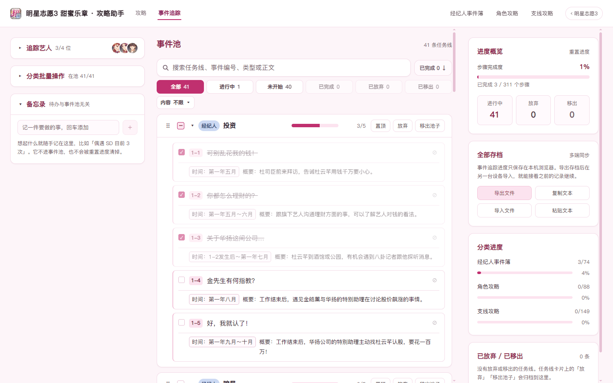

# 明星志愿3 攻略助手

《明星志愿3》与《明星志愿3 甜蜜乐章》的攻略网页版整理：攻略浏览、通告库、六大通告、事件追踪器（含备忘录）与 CG 图鉴。纯静态站点，无需登录，进度保存在本机浏览器。

> 当前版本：**v1.8.2**

## 两个站点

| 入口 | 站点 | 主题 |
| --- | --- | --- |
| `index.html`（`/`） | 明星志愿3 · 攻略助手 | 玫瑰粉 |
| `sweet.html`（`/sweet.html`） | 明星志愿3 甜蜜乐章 · 攻略助手 | 糖果粉 |

- 同一套排版与设计令牌，甜蜜乐章只换主题色；两个站点各有自己的攻略、图鉴与追踪数据
- 互不干扰：目录顺序、追踪进度、备忘录与存档各自独立，改一边不会动到另一边
- 顶栏右上角的胶囊可以整页跳到另一个站点
- 甜蜜乐章收录 24 节正文：经纪人事件簿 10 节 / 角色攻略 8 位（感情线与约会选项合并进同一角色页）/ 支线攻略 6 条

## 界面预览

**攻略浏览**


**通告库**


**六大通告**


**事件追踪**


**甜蜜乐章事件追踪**



**CG 图鉴**


**甜蜜乐章 CG 图鉴**


## 功能模块

全站图片按需加载：图片多的页面只加载看得到的部分，加载期间留占位、不会跳版，点开看大图仍是完整清晰度的原图。

### 攻略浏览

- 按经纪人事件簿、艺人事件簿、路欧桑剧情整理、六大特殊通告、其他事件分类组织，逐层展开至具体事件
- 支持按标题、正文与事件编号搜索，结果直接定位到对应内容
- 每个小节有独立锚点链接，可直接分享
- 宽屏右侧常驻本页大纲，随滚动高亮当前小节
- 目录顺序可拖拽调整，顺序仅保存在本机
- 出过 CG 的事件在编号旁带一枚金色 CG 徽标，点一下直达图鉴里的那一张；顺着图鉴回来仍落在同一条事件上
- 「小贴士」便签页把培训与打工、证书取得、制作人擅长方向、颁奖典礼日程、关键事件等速查表集中成一页，随时翻查

### 通告库

- 收录 1587 条通告与 2745 个角色要求，涵盖电影、电视剧、唱片、广告、主持五类
- 支持按分类、年份、公司、难度筛选，并按名称、编号、制作人、角色名搜索
- 列表展示难度星级与角色构成，同一页卡片高度对齐；支持每页 12 / 24 / 48 / 96 条分页
- 详情列出每个角色的能力要求区间、特殊要求（搞笑、反串、暴力、反派等），以及拍摄期间按天结算的属性增减
- 「能力对照」页汇总难度换算、类型能力要求、放水情况、艺人成长率等速查表，供接通告前核对

### 六大通告

- 把六张特殊通告（笑傲天际 / 末日战士 / 万年之恋 / 落入凡间的天使 / 昆仑历险 / 银河）的接演条件逐条摊成可勾选清单，一格一条、不再埋在长句里
- 六张通告卡**默认全部启用**，不想做的取消卡头勾选，再指派艺人：昆仑有男主 / 女主一 / 女主二三个角色位，银河需先凑齐团体再锁定或解散重组；末日战士、笑傲天际是候选池（最多 4 人，选满后不再显示加人下拉），万年之恋、落入凡间的天使只能选 1 位（下拉变「换人」即替换）
- 一条条件落在多位艺人身上时按人拆行（每位一行、各自勾选与缺口），不会把四五个人的控件挤在一行里
- 条件行按归属读数值：公司共享（同名的计数 / 资金）、按艺人、按团体、按角色位、仅本通告；同一艺人挂两张卡时证书与属性共用一份状态，改一处多卡同步，并标「共享」徽标
- **提前准备带来源备注**：道具与前置计数行下方常驻一行淡灰小字，写清怎么拿（哪个综艺的奖品、在哪买、跟谁领、要跑几次），不用 hover；证书行不铺备注，课程等级与属性缺口仍在 ▸ 展开里
- **证书 → 课程跟踪**：证书行点「已取得」，展开后逐门点课程等级（未上 → 初级 → 中级 → 高级 → 专业），达标转绿，缺口按「还差 N 项」提示
- **集中数值录入**：顶部一张小表一次填完旗下艺人的 10 项属性（演技 / 歌艺 / 口才 / 仪态 / 动感 / 体能 / 才智 / 自信 / 名气 / 人气，人气是 0–5 等级）与团体名气 / 人气，条件行自动跟着算缺口；数值只是参考、不强制填，填不填都不影响勾选进度
- 时间线备注只读、零状态，每条直接跳回事件追踪器；进度独立保存，与追踪器、CG 图鉴互不干扰

### 事件追踪

- 选定当前签约艺人（最多 4 位）后，按章节自动生成相关事件线
- 路欧桑剧情整理按「只有桑禾蓓 / 只有路风 / 路风和桑禾蓓 / 路风和欧怡青在旗下」分成五条分支，只把当前组合成立的那几条放进池子；路风、桑禾蓓、欧怡青个人页里的同名恋情章节与它重复，不入池、仍可照常浏览
- 每个事件可标记完成或单独放弃，放弃的步骤不计入统计
- 支持按状态（进行中 / 未开始 / 已完成 / 已放弃 / 已移出）与内容筛选，并支持搜索
- 支持拖拽排序、置顶重要任务线、按分类批量移出或恢复
- 提供完成度总览
- **备忘录**：追踪器内的待办清单，独立于追踪进度，重置进度不会清除其内容
- 同一套追踪器也用在甜蜜乐章，两个站点的进度、备忘录与存档互不影响

### CG 图鉴

- 收录 204 张 CG，按经纪人 + 18 位艺人分成 19 组，侧栏每行带人物头像与该组收集进度；选中的分组写进地址栏，刷新或分享链接都停在原分组
- 卡片支持大 / 中 / 小三档尺寸切换（顶栏分段开关，默认中档）：中档底部单行排 收集 / 编号 / 名称 / 攻略›，经纪人头像 + 名称浮在图片左上角（仅「全部」视图）；大档底部一行放下 收集 / 经纪人 / 编号 / 名称 / 攻略›，图片干净无浮层；小档把序号与归属都浮到图片上（左上归属 / 右上序号）、底部只留 收集 / 名称 / 攻略› 且整体缩小。底栏名称始终单行完整显示不截断；点开看大图，图下给出完整获得条件
- 能对上具体事件的 CG 卡片带「攻略›」入口，直接跳到出处那条事件（路欧桑感情线跳到剧情整理页的对应分支，不会落到艺人自己的页面）
- 大图支持 ← / → 翻页、Esc 关闭；在图上即可标记已收集，与网格里的勾选互通
- 「只看未收集」快速查漏；「全部」分组按 60 张分页加载
- **清除已收集**：二次确认后只清空 CG 勾选，追踪进度与备忘录不受影响；误点可在撤销条里一键撤回

### 甜蜜乐章攻略浏览

- 与明星志愿3 平级的独立站点（`sweet.html`），糖果粉主题，排版和组件与明星志愿3 完全一致
- 友好度 / 好感度上升单独标成灰 tag，出 CG 的事件用玫红卡 + 金色徽标；点徽标直达图鉴里对应的那一张，从图鉴的「攻略 ›」回来仍落在同一条事件
- 约会对话选项渲染成问答卡（地点小标题 + 编号提问 + 多行回答）
- 角色攻略 8 位与支线 5 位在目录人名左侧带圆圈头像，角色正文头部带封面图
- 顶栏「攻略分类」胶囊可一键定位经纪人事件簿 / 角色攻略 / 支线攻略，并高亮当前所在类目

### 甜蜜乐章事件追踪

- 与明星志愿3 共用同一套追踪器：交互与外观一致，上限、分组与文案按甜蜜乐章的规则来
- **主角杜云芊固定占一个签约位**：旗下最多 4 位（主角 + 3 位艺人），她不可移出、不可解约；满员后再点别的艺人会自动记成「已解约」并保留已有进度，不会把主角挤掉。解约的人仍留在名单里，之后还能复签
- 事件按经纪人事件簿 / 角色攻略 / 支线攻略分成三组；经纪人事件簿只收主线攻略、公司改建攻略、服装获得方法与剧情三页，自制通告一览之类的资料页不进待办
- 每个事件只占一行标题，正文拆成「时间 / 概要 / 提示」常驻显示在标题下方、不用展开：时间是极淡的小标签、概要是正文、提示用左侧金色细线标出，这些文字同样能被搜索命中
- 卡片头部只保留置顶 / 放弃 / 移出池子；整条线仍可点标题折叠，方便快速扫事件名

### 甜蜜乐章 CG 图鉴

- 按主角杜云芊 + 8 位角色分成 9 组，共 83 张（84 条条目），侧栏带人物头像与收集进度，选中的分组写进地址栏
- **每人一套新编号**：不管原图的游戏编号是几，组内一律从 `CG 01` 起连号，顺序已按人工调整定稿
- **共用一张 CG**：丹尼斯与史蒂芬线里那张图内容完全相同，只收一份、只算一张，两条线的卡片都指向同一张，点亮一次两边都亮
- **攻略 ⇄ CG 双向可跳**：能对上具体事件的 41 张 CG 以事件标题作名称（卡面单行截断、悬停看全名、灯箱显示全名），卡片底部「攻略 ›」跳回原文那条事件并滚到该块闪一下；攻略页的 CG 徽标反向点进图鉴，直接定位到那一张
- **结局 CG 单独命名**：事业结局没有对应事件，名称为 CG 14 天王巨星 / CG 15 歌手、偶像 / CG 18 演员 / CG 19 经纪人 / CG 21 打工达人 / CG 22 自由工作者 / CG 23 制作人 / CG 24 千金小姐 / CG 25 公司倒闭
- 用法与明星志愿3 图鉴一致：大 / 中 / 小三档尺寸、只看未收集、大图 ← / → 翻页与 Esc 关闭
- 顶栏和明星志愿3 一样有「全部存档」：勾过的 CG 与追踪进度打成一个文件，换设备导入即可接着收集

## 存档与备份

事件追踪、CG 图鉴与六大通告打包在**同一个存档文件**里（`MXZY3-存档-<时间戳>.json`），一次导出 / 导入即可带走全部本机进度：

- 「全部存档」在事件追踪器右侧栏、CG 图鉴顶栏、六大通告页顶栏都有入口，三处功能完全一样
- 导入前先看摘要（追踪进度、CG 张数、六大通告已配置张数、导出时间），再选择合并或覆盖
- 追踪进度按事件内容重新对齐，攻略更新过也不会错位；CG 收集与六大通告只合并不清空，已勾的不会被清掉
- 旧版存档仍可导入，只恢复它包含的那部分
- 甜蜜乐章同样能整体备份，进度与 CG 收集打成一个文件（`甜蜜乐章-存档-<时间戳>.json`），入口在事件追踪器与 CG 图鉴。两个站点的存档不能互相导入，各导各的

## 数据与存储

无需账号，追踪进度、CG 收集、六大通告配置与备忘录都保存在本机浏览器里，换设备请用「全部存档」迁移。清理浏览器数据会一并清空这些记录，建议定期导出备份。站点是纯静态页面 + Hash 路由，可直接部署至任意静态托管。

## 运行

需 Node 20+：

```bash
npm install
npm run dev         # 开发服务器
npm run build       # 构建至 dist/
npm run preview     # 预览构建产物
npm run typecheck   # 类型检查
npm run test:guide  # 数据校验
```

## 内容维护

页面内容全部来自 `public/data/*.json`，改内容只需重新生成 JSON，不用重新构建。正文、通告、CG 与「攻略 ⇄ CG」映射各条流水线的做法、约定与校验方式见 [`docs/content-pipeline.md`](docs/content-pipeline.md)。

## 说明

攻略文字与 CG 图片版权归原作者与游戏厂商所有。本仓库仅改善阅读体验与个人进度管理，不含游戏本体程序；`public/images/cg/` 收录的是网上公开流传的 CG 整理图的压缩副本，供个人收集对照使用。
