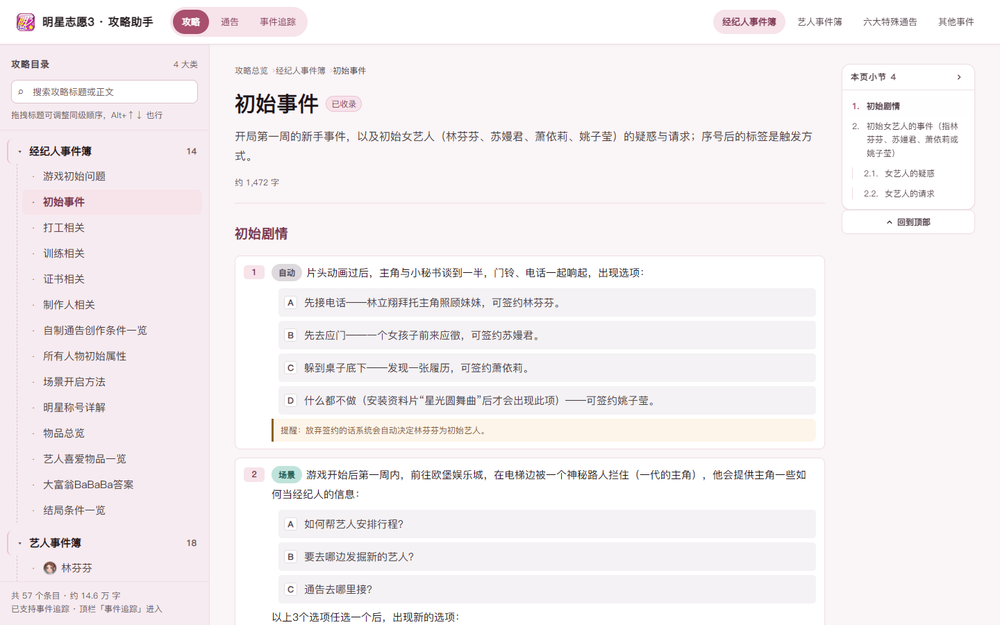
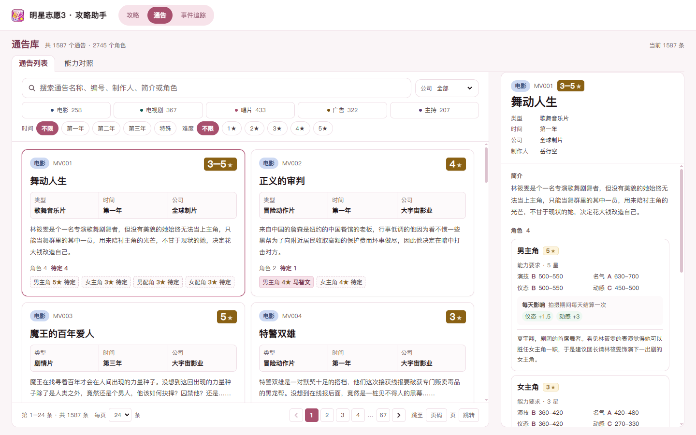
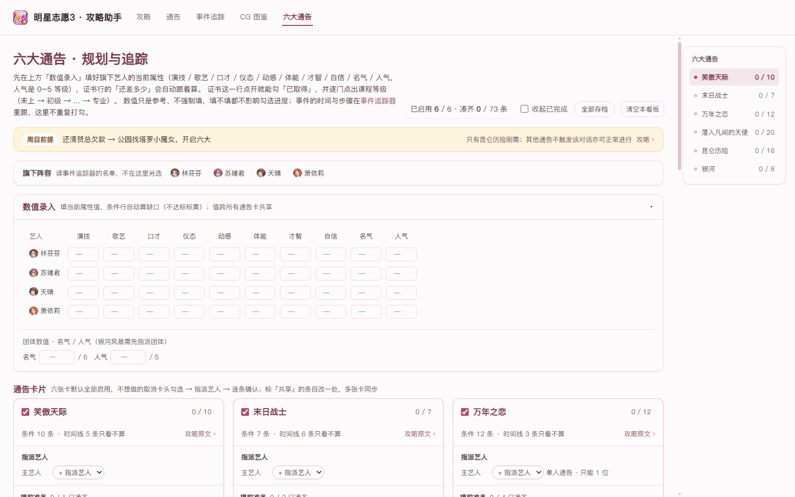
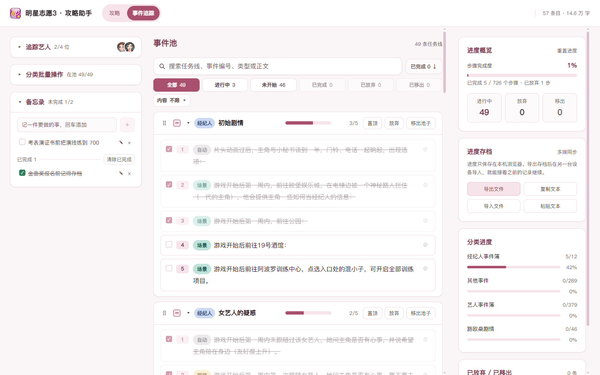

# 明星志愿3 攻略助手

《明星志愿3》攻略的网页版整理，提供攻略浏览、通告库、事件追踪器（含备忘录）与 CG 图鉴。纯静态站点，无服务端依赖，进度保存在浏览器本地。

> 当前版本：**v1.5.0**

## 界面预览

**攻略浏览**



**通告库**



**六大通告**



**事件追踪**



**CG 图鉴**


## 功能模块

### 攻略浏览

- 按经纪人事件簿、艺人事件簿、路欧桑剧情整理、六大特殊通告、其他事件分类组织，逐层展开至具体事件
- 支持按标题、正文与事件编号搜索，结果直接定位到对应内容
- 每个小节有独立锚点链接，可直接分享
- 宽屏右侧常驻本页大纲，随滚动高亮当前小节
- 目录顺序可拖拽调整，顺序仅保存在本机
- 出过 CG 的事件在编号旁带一枚金色 CG 徽标，点一下直达图鉴里的那一张；顺着图鉴回来仍落在同一条事件上
- 「小贴士」便签页把培训与打工、证书取得、制作人擅长方向、颁奖典礼日程、关键事件等速查表集中成一页，随时翻查

### 通告库

- 收录 1587 条通告与 2745 个角色要求，涵盖电影、电视剧、唱片、广告、主持五类
- 支持按分类、年份、公司、难度筛选，并按名称、编号、制作人、角色名搜索
- 列表展示难度星级与角色构成，同一页卡片高度对齐；支持每页 12 / 24 / 48 / 96 条分页
- 详情列出每个角色的能力要求区间、特殊要求（搞笑、反串、暴力、反派等），以及拍摄期间按天结算的属性增减
- 「能力对照」页汇总难度换算、类型能力要求、放水情况、艺人成长率等速查表，供接通告前核对

### 六大通告

- 把六张特殊通告（笑傲天际 / 末日战士 / 万年之恋 / 落入凡间的天使 / 昆仑历险 / 银河）的接演条件逐条摊成可勾选清单，一格一条、不再埋在长句里
- 六张通告卡**默认全部启用**，不想做的取消卡头勾选，再指派艺人：昆仑有男主 / 女主一 / 女主二三个角色位，银河需先凑齐团体再锁定或解散重组；末日战士、笑傲天际是候选池（最多 4 人，选满后不再显示加人下拉），万年之恋、落入凡间的天使只能选 1 位（下拉变「换人」即替换）
- 一条条件落在多位艺人身上时按人拆行（每位一行、各自勾选与缺口），不会把四五个人的控件挤在一行里
- 条件行按归属读数值：公司共享（同名的计数 / 资金）、按艺人、按团体、按角色位、仅本通告；同一艺人挂两张卡时证书与属性共用一份状态，改一处多卡同步，并标「共享」徽标
- **提前准备带来源备注**：道具与前置计数行下方常驻一行淡灰小字，写清怎么拿（哪个综艺的奖品、在哪买、跟谁领、要跑几次），不用 hover；证书行不铺备注，课程等级与属性缺口仍在 ▸ 展开里
- **证书 → 课程跟踪**：证书行点「已取得」，展开后逐门点课程等级（未上 → 初级 → 中级 → 高级 → 专业），达标转绿，缺口按「还差 N 项」提示
- **集中数值录入**：顶部一张小表一次填完旗下艺人的 10 项属性（演技 / 歌艺 / 口才 / 仪态 / 动感 / 体能 / 才智 / 自信 / 名气 / 人气，人气是 0–5 等级）与团体名气 / 人气，条件行自动跟着算缺口；数值只是参考、不强制填，填不填都不影响勾选进度
- 时间线备注只读、零状态，每条直接跳回事件追踪器；进度独立存档（`guide.specials.v1`），与追踪器、CG 图鉴互不干扰

### 事件追踪

- 选定当前签约艺人（最多 4 位）后，按章节自动生成相关事件线
- 路欧桑剧情整理按「只有桑禾蓓 / 只有路风 / 路风和桑禾蓓 / 路风和欧怡青在旗下」分成五条分支，只把当前组合成立的那几条放进池子；路风、桑禾蓓、欧怡青个人页里的同名恋情章节与它重复，不入池、仍可照常浏览
- 每个事件可标记完成或单独放弃，放弃的步骤不计入统计
- 支持按状态（进行中 / 未开始 / 已完成 / 已放弃 / 已移出）与内容筛选，并支持搜索
- 支持拖拽排序、置顶重要任务线、按分类批量移出或恢复
- 提供完成度总览
- **备忘录**：追踪器内的待办清单，独立于追踪进度，重置进度不会清除其内容

### CG 图鉴

- 收录 204 张 CG，按经纪人 + 18 位艺人分成 19 组，侧栏每行带人物头像与该组收集进度；选中的分组写进地址栏，刷新或分享链接都停在原分组
- 卡片支持大 / 中 / 小三档尺寸切换（顶栏分段开关，纯本地选择、不持久化、默认中档）：中档底部单行排 收集 / 编号 / 名称 / 攻略›，经纪人头像 + 名称浮在图片左上角（仅「全部」视图）；大档底部一行放下 收集 / 经纪人 / 编号 / 名称 / 攻略›，图片干净无浮层；小档把序号与归属都浮到图片上（左上归属 / 右上序号）、底部只留 收集 / 名称 / 攻略› 且整体缩小。底栏名称始终单行完整显示不截断；点开看大图，图下给出完整获得条件
- 能对上具体事件的 CG 卡片带「攻略›」入口，直接跳到出处那条事件（路欧桑感情线跳到剧情整理页的对应分支，不会落到艺人自己的页面）
- 大图支持 ← / → 翻页、Esc 关闭；在图上即可标记已收集，与网格里的勾选互通
- 「只看未收集」快速查漏；「全部」分组按 60 张分页加载
- **清除已收集**：二次确认后只清空 CG 勾选，追踪进度与备忘录不受影响；误点可在撤销条里一键撤回

## 存档与备份

事件追踪、CG 图鉴与六大通告共用**同一个存档文件**（`MXZY3-存档-<时间戳>.json`），一次导出/导入即可带走全部本地进度：

- 「全部存档」面板在三个页面都有入口——事件追踪器右侧栏、CG 图鉴顶栏、六大通告页顶栏，三处是同一个组件，导出文件、复制文本、导入文件、粘贴文本从任意一处走都一样
- 导入前先预览存档摘要（追踪进度、CG 张数、六大通告已配置张数、导出时间），再选择合并或覆盖
- 导入追踪进度时按事件内容重新对齐，攻略更新过也不会错位；CG 收集固定按并集合并，已勾的不会被清掉
- 六大通告的勾选 / 指派 / 数值 / 课程等级 / 证书都打包进同一文件；导入时数值与计数取较大值、其余（启用、指派、已勾、团体锁定）并集合并，已做的不会丢
- 旧版纯追踪存档（`stardom3-tracker-save`）与不含六大通告的两段式存档仍可导入，只恢复各自已有的部分

## 数据与存储

页面无账号体系，追踪进度、CG 收集、六大通告配置与备忘录均保存在浏览器本地存储（`guide.progress.v1`、`guide.cg.v1`、`guide.specials.v1`、`guide.memo.v1` 等互不干扰，重置追踪进度不会清掉 CG 与六大通告，反之亦然）；清理浏览器数据会同时清除记录，建议通过「全部存档」导出备份。站点使用 Hash 路由，可直接部署至任意静态托管。

## 数据流水线

页面运行时从 `public/data/*.json` 加载内容，修改内容只需重新生成 JSON，无需重新构建：

- 攻略：`sources/` 下的正文与补充文本 → `scripts/extract_guide.py` → `guide.json`
- 通告：`sources/notices/` 下的原表 → `scripts/extract_notices.py` → `notices.json`
- CG 图鉴：`outputs/明星志愿3_CG图鉴/`（本地素材，不入库）→ `scripts/extract_cg.py`（需 Pillow）→ `cg.json` 与 `public/images/cg/*.webp`
- 攻略 ⇄ CG 的对应关系手写在两张小表里，由上面两条管线分别注入：`sources/cg-links.tsv` 记一对一（事件号 + 最内层章节名 → CG），`sources/cg-node-links.tsv` 记多对一（多张 CG 共用一个事件，如美丽之星写真集 18 张）。写错事件号或章节名会让生成直接失败，不会静默断链
- 校验：`npm run test:guide`（Python unittest，交叉核对抽取结果与原表）
- 界面验证：`scripts/cdp_*.mjs`（需 dev server 与 Chrome 调试端口）

## 运行

需 Node 20+：

```bash
npm install
npm run dev         # 开发服务器
npm run build       # 构建至 dist/
npm run preview     # 预览构建产物
npm run typecheck   # 类型检查
npm run test:guide  # 数据校验
```

## 说明

攻略文字与 CG 图片版权归原作者与游戏厂商所有。本仓库仅改善阅读体验与个人进度管理，不含游戏本体程序；`public/images/cg/` 收录的是网上公开流传的 CG 整理图的压缩副本，供个人收集对照使用。

## 更新日志

### v1.5.0

- 新增「六大通告」页签（第 5 个 tab）：把笑傲天际 / 末日战士 / 万年之恋 / 落入凡间的天使 / 昆仑历险 / 银河六张特殊通告的条件逐条摊成可勾选清单
  - 六张卡默认全部启用，不想做的自行取消勾选，再指派艺人（昆仑三个角色位、银河团体锁定 / 解散重组）；候选池最多 4 人，万年之恋 / 落入凡间的天使只能 1 人
  - 条件落在多位艺人身上时按人拆行，每位一行、各自勾选与缺口
  - 「提前准备」道具行下方常驻一行获取来源备注（数据表的 hint，无需额外录入）
  - 属性 / 资源是清单勾选（勾选即权威进度），数字只是可选参考、不 gate
  - 证书行点「已取得」，展开后逐门点课程等级（未上 → 初级 → 中级 → 高级 → 专业），达标转绿
  - 顶部「数值录入」集中填 10 项属性（演技 / 歌艺 / 口才 / 仪态 / 动感 / 体能 / 才智 / 自信 / 名气 / 人气，人气 0–5）与团体名气 / 人气，一次填完、所有通告卡共享，条件行自动算缺口
  - 同名证书 / 公司数值改一处多卡同步，带「共享」徽标
  - 时间线备注只读、零状态，每条跳回事件追踪器
  - 进度独立存档 `guide.specials.v1`，与追踪器、CG 图鉴互不干扰；并已并入「全部存档」导出/导入，可与另外两块一起多端迁移
  - 右侧「六大通告」跳转面板（≥1120px 显示）：一块圆角卡片列出六张卡入口，滚动时高亮当前卡片（越过容器上沿的最后一张），点击平滑滚到对应卡；启用时每条右对齐显示 `met / total` 进度
- 数据管线新增 `sources/special-notices.tsv` → `scripts/extract_specials.py` → `public/data/specials.json`（73 条条件 + 28 条只读备注，深链逐条对过攻略事件号）

### v1.4.2

- CG 图鉴新增卡片尺寸切换（大 / 中 / 小）：
  - 顶栏分段开关，纯本地选择、不持久化、默认中档；网格最小卡宽随档位变化（大 520px / 中 380px / 小 300px）
  - 中档：底部单行排 收集 / 编号 / 名称 / 攻略›，经纪人头像 + 名称浮在图片左上角（仅「全部」视图）
  - 大档：底部一行放下 收集 / 经纪人 / 编号 / 名称 / 攻略›，图片干净无浮层
  - 小档：序号与归属都浮到图片上（左上归属 / 右上序号），底部只留 收集 / 名称 / 攻略›，字体、信息条高度、按钮、标签整体缩小
  - 去掉图片与底栏之间的细分隔线；底栏名称始终单行完整显示不截断（实测 204/204 张零截断）
  - 修复分组视图下卡片因缺失分组信息而崩溃的白屏问题

### v1.4.1

- CG 图鉴卡片排版修正（纯 UI，无内容 / 数据变更）：
  - 删除图片右上角冗余对勾，收集状态只由底部芯片与图片彩色表达
  - 卡片信息栏回到单行：收集芯片 + 序号 + 名称 + 攻略›；归属头像标签移回图片左上角浮层（仅「全部」视图）
  - 底栏四个元素统一 14px 字号、水平对齐；信息条加高、图片与底栏间加细分隔线
  - 网格最小卡宽提到 380px，名称单行完整显示不截断（实测 204/204 张零截断）
